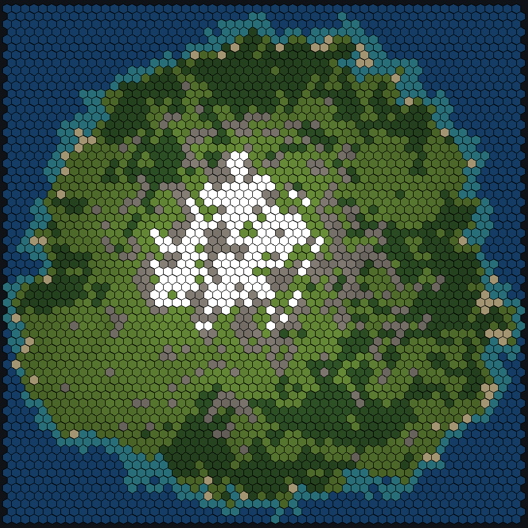
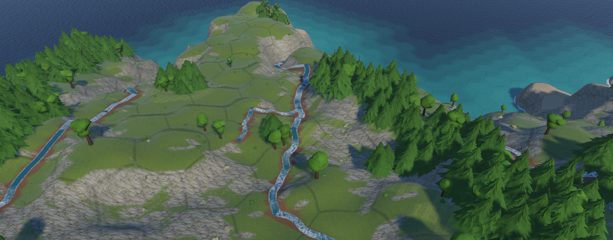

# Logiheim

A hex strategy map built in **Godot 4.3+**, with terrain generated in **Gaea**.

Gaea exports a heightmap and terrain masks. Logiheim samples them onto a hex grid and draws a **realistic, soft-stepped landscape**. Every hex keeps its own height as a gentle terrace, so the board still reads as hexes, but the ground between them is continuous terrain with real relief, photo-scanned textures, carved rivers, a proper sea, forests, rocks and grass.





## Features

- **Hex size:** set by `base_hex_size` in the settings (no longer changed in game; zooming out switches to the coarser, generalised levels).
- **Variable map size:** each map defines its own world size in metres, square or not. The grid fits itself to the map.
- **Island shape:** land is low near the coast and rises to a hilly heart: height above the sea is scaled by distance from the coast (`coast_height`, `inland_height`, `coast_reach`).
- **Soft-stepped terrain:** each hex has a plateau at its stepped height (`step_height`) that slopes smoothly into its neighbours (`step_softness`), with the real Gaea relief layered on top (`terrain_detail`). A final blur (`terrain_smoothing`) rounds off the terrace edges, and a slope limit (`max_slope`, about 51 degrees) cuts back anything steeper, so the ground is never a vertical wall (only waterfall faces are exempt). Bands of harder rock break out of the steepest crests — fractured slabs lying along the slope, half buried, standing proud as a low step — with fallen boulders below them (`overhang_spacing`). Every rock and boulder is seated on the lowest ground under its footprint and sunk into it, so none float. The sea floor deepens offshore.
- **Multi-scale / LOD:** several hex scales (default ×1, ×3, ×8). The camera switches to coarser levels as you zoom out. Coarser levels keep a fine terrain grid (10 m, 15 m) and take their coast — from the sea floor to ~30 m up — straight from the finest level, so the island and its spits, bars, islets and reefs keep their shape when zooming out. Levels are linked parent ↔ children, so you can use them as regions in gameplay.
- **Photo-scanned textures:** 36 CC0 PBR sets from ambientCG (colour, height, normal, AO, roughness; see `assets/textures/terrain/CREDITS.md`). Each terrain layer has a family of textures chosen per pixel from moisture, height, slope, convexity, river beds, volcanic ground and farmland: grass is lush meadow, plain grass, sparse dry grass or upland moss; forest floor is leaf litter, plain or conifer needles; rock is granite, layered cliff, mossy or dark slate/basalt; sand is beach, dune, wet or pebble shingle; earth is dirt, mud, gravel scree, ploughed soil or volcanic ash; snow has rocky and icy patches. Grass also turns to heather moor, hay meadow or stony upland grass, forest floors show roots, and flat high rock becomes alpine stony ground. Lowland grass blooms into flower meadows. Textures are block-compressed in video memory. Boulders, tree bark, timber props and the lava pool use the same texture set. Every texture is laid down with hex tiling (each small patch at its own random rotation and offset, blended by height), so nothing visibly repeats. Layers mix by **height-based blending**, so grass grows between stones and sand fills cracks. Steep ground turns to rock, with scree and bare earth on the slopes below it. Bare rock also shows on ridges and crests, in broken patches on high ground, on sea cliffs down to the water, and as outcrops poking through grassy slopes. Beaches form at the waterline, dunes drift inland on low coasts, slow lowland rivers drop sand bars, and open grassland has worn dry patches. Rock is weathered: a Gaussian-like detail height field (summed noise octaves) with scattered weathering pits bends its normals and shades its crevices, with mineral staining, lichen on gentler faces and strata on steep ones; rocky ground also gets real knobs, hollows and pits in the terrain mesh (`TerrainSurface.add_rock_relief`), kept ~20 m clear of trails, rivers and cleared ground so paths stay smooth. All ground has a mid-scale Gaussian-like variation in tone. Textures follow the real landscape (`natural_texturing`) instead of painting each hex one colour, with large-scale variation to hide tiling.
- **Coastal landforms** (`landforms_enabled`, each only where the map has room): gentle coasts become wide sand beaches with shallow sandy shelves; the steepest stretches become cliffs dropping to deep water, with sea stacks (and worn stumps) standing off them; sand spits grow from beaches along the shore and hook back at the tip; a barrier lagoon (a sand bar bowed out from a beach, with a tidal inlet and shallow calm water behind); a tombolo tying an islet to the shore (an islet is raised if there is none); and an atoll in open sea (a ring reef with low sandy islets and gaps around a shallow lagoon). What counts as gentle or steep is relative to each map's coast. Nothing is drawn with a ruler: bars and spits wander and swell, and everything the coast shaping changed is then worn — domain-warped outlines, tidal channels and wash-overs cutting through bars and reefs (sometimes breaking them into barrier islands), slumped sand faces and fine roughness. The sea floor deepens with each point's own distance from the shore (no hex-shaped shallows), the waterline is rounded, and the shelf breaks away irregularly towards the map edge.
- **Sea:** a 3D surface (dense near the island) moved by six Gerstner swells from spread directions, each rising and fading in drifting wave groups, with patchy ripples (no repeating pattern), that knows the water depth from the terrain's height map: open-sea swell, calm shallows, and breakers that lift and roll onto the shore along the surf lines. Depth-coloured water using the depth buffer, refraction of the sea floor, foam lapping at the shoreline, whitecaps in strong wind and sky reflections. Spray bursts where waves hit the coast (harder on rocky shores), droplets splash up at the foot of waterfalls, and rivers churn and throw up spray where they run into the sea or a lake (the river fades into the sea there instead of ending in a slab).
- **Volcano:** only where a whole cone fits (land all round, even ground under it); otherwise the map has none. An inland volcanic cone (`volcano_count`, `volcano_radius`, `volcano_height`) with radial gullies, a crater holding a glowing, churning lava pool and a smoke plume drifting downwind. It is built before water is routed, so rivers run off its flanks. Around it the ground is basalt: dark bare rock and ash on the cone, old lava flows streaking out over the land, columnar jointing (tall prisms with dark joints) on steep faces, and dark basalt boulders.
- **Seeded:** everything procedural (lakes, fjords, volcano, river meanders, wetlands, resources, trails, caves, vegetation, props, animals) comes from the map seed (`seed`, the HUD's seed box, F5, or `--seed=N`). The same seed always builds the same world from the same Gaea terrain.
- **Caves** (`cave_count`): cave systems in the hills with one to three entrances each, holding silver, gems, iron, coal or soapstone (lava tubes on the volcano hold gems and silver). Each entrance is set into the hill: an alcove cut back into the slope, and at its back a sculpted rock face (drawn with the terrain's own rock material, leaning back and sinking its ragged edges into the hillside) with a clean-edged arch opening onto a black tunnel, with its own always-visible marker. Caves have real, explorable interiors (C): chambers with lumpy rock walls and flat floors, stalactites and stalagmites, the cave's ore and crystals on the floor, torch and crystal light, joined by winding tunnels to every entrance. Exploring hides the surface world; the walls face inwards, so the view looks straight in as a cutaway. Trails lead to every cave.
- **Trails** (`roads_enabled`, `road_spacing`, `road_width`): a network linking natural settlement spots (flat, dry ground near the coast, rivers and lakes), routed with A* around steep ground, rock, snow, wetland and water, merging where routes share a way, crossing rivers on wooden bridges. Every land resource deposit gets a spur trail to the network. Trails keep to flat ground (steep grades, steep ground underfoot and following rivers cost far more when routing), never climb steeper than 15% where a cut or fill of at most 2.5 m can manage it (beyond that they follow the ground rather than ride on embankments), never dam a stream (they ford down to it), are levelled across their width and eased along their length into the ground (the banks either side ease out over a width that grows with the depth of the cut or fill, about 1 in 3, and are smoothed so they meld into the land), and are draped closely over the ground, their surface following the land they cross (blending gradually from one to the next): packed earth and gravel with wheel ruts and a grass strip over open land, a pale sand track on beaches and dunes, a paved way of set stones over rock, a corduroy road of logs laid across over bog, dark earth strewn with needles and roots in forest, and packed snow with grey ruts up high. Trails that share hexes share one line, near-parallel trails are merged, and routes reuse a nearby bridge rather than build another; a bridge is only built where a trail really crosses from one bank to the other (never lengthwise along a river), just long enough to reach dry bank on both sides, clear of the water. The bridge suits its crossing: a footbridge of three logs with one hand rail over a brook, a humped stone arch with parapets where the banks are rock, a braced timber trestle over a long span, and a plank bridge on piers otherwise. Their hexes are marked (`level.road`) and halve the movement cost (`level.move_cost(i)`, shown when hovering a hex).
- **Fjords:** rivers that reach the sea through high ground can become fjords: long, narrow, curving sea inlets with a U-shaped trough and steep rock walls, widest at the mouth and narrowing to a rounded head, often with the river falling into it (`fjord_count`, `fjord_min_relief`, `fjord_length`, `fjord_width`, `fjord_depth`).
- **Arable land:** flat, low, fertile ground (best on floodplains) is farmed in irregular parcels like old field systems (noise-warped Voronoi cells), some split into long strips: ploughed furrows, young crops, ripening grain and hay meadow, each with its own furrow direction, with grassy margins and patchy hedgerows. Farm field props are irregular rounded plots.
- **Wetlands** (`wetland_amount`): flat, damp, soft ground, hollows that hold water and high flat plateaus become bog (sphagnum with heather hummocks) or, lower down, swamp and fen (sedge, fen grass, mud) with reed beds, reed clumps and dark pools of standing water that mirror the sky. Trees mostly stay out; farmland gives way.
- **Rivers and lakes:** water is routed over the actual terrain (a priority flood on a 10 m grid), so rivers follow real valleys, join into bigger rivers and collect in lakes where hollows fill up.
  - Width grows with the square root of the land draining into the river, like real rivers (`river_width_scale`). Rivers are settled onto the final ground (no water ever runs above its banks). Rivers are born thin at their source and widen over the first few hundred metres. Courses wind naturally (an irregular wander everywhere, plus meanders on flat ground) and open out into funnel-shaped estuaries at the sea (up to ~3x wider over the last ~250 m, with banks that swell and pinch), where each river is melded into the sea: over its last stretch the river's water takes the sea's colour and fades out into the sea. River water draws after the sea and leaves no depth where it is faded out, so the sea is never hidden under it (no grey sheets or square ends). In the mouth itself the current holds the swell and surf back: the sea lies still there (no waves heaving up over the banks), with no shore foam line where it floods over the river bed and a soft water edge rather than a hard one. The estuary bed takes the beach's sand colour near the coast. The sea carries the outflow on as a gentle plume with foam lines along its edges. Stub rivers (under ~90 m with nothing flowing into them) are dropped. Where a river runs into or out of a lake it carries on a way into the lake at its level, taking the lake's colour and fading out over the lake's own water, so there is no dry gap or square end at the shore. Rivers are split at a lake only where they really reach its water: lakes are worked out again from the final ground, and if one has drained or shrunk the rivers are placed again so they never end in dry ground, and a river that only passes the dry rim of a lake runs on unbroken. Rivers cut valleys: the land around them comes down to a floor just above the water, with walls rising to the surrounding ground (`valley_slope`, `valley_reach`). Where the ground drops away cliff-steep, the drop is gathered into a waterfall, white from lip to plunge pool, with spray at its foot (`waterfall_min_drop`). Oxbow lakes — crescents of still water where a meander was cut off — lie beside slow lowland rivers where the ground is flat enough. Wide rivers that reach the sea over low, flat land split into a delta of 2–4 distributaries (`delta_min_width`, `delta_height`, `delta_max_branches`).
  - Water runs in carved channels with muddy beds and banks, and its level never rises downstream, so rivers cut gorges instead of flowing uphill.
  - The water is a 3D surface: several vertices across each river, slightly crowned, with waves running downstream at the flow's speed and standing waves in rapids, lit by that shape. Only genuinely steep water (measured on the shaped island, not the raw heightmap) turns white.
  - Flow speed follows the slope (flow-mapped, so fast and slow water never smear). Rapids appear where the real landscape is steep, and small cascades at each terrace step. Trees keep clear of the banks.
  - A Gaea `river` mask adds rivers wherever it is painted.
  - Besides natural hollows, `lake_count` extra lakes are made by damming flat river valleys behind a natural moraine, plus a highland tarn. A Gaea `lake` mask paints lakes exactly. Dams are shaped as sloping moraines, lake shores are smooth curves (a blurred lake mask, gently warped) rather than following the 10 m flow grid, and the lake water is built on the fine terrain grid so the shoreline is where the ground meets the water.
- **Floodplains:** flat, low land along big rivers is levelled into lush meadow on silt, with oxbow ponds. When it rains, the rivers flood: water spreads out from the river over the floodplain and drains away after (`flood` in the HUD). Floodplain hexes are flagged for gameplay and make the best farmland.
- **Natural resources (25, Norse-themed), as deposits:** each resource is a deposit that spans several hexes depending on how abundant it is. Forests and farmland cover many hexes, ore veins a few, gems one. Deposits are richest at their centre, rare finds keep apart, and every lake is one freshwater fishery (`resource_abundance`). Where the land runs right off the edge of the map (as on Placeholder Valley), the last 130 m become one clean skirt sloping smoothly from the land into the sea - no inlets or notches - and within 180 m of such an edge (`TerrainSurface.EDGE_MARGIN`) nothing is placed: no beaches, cliffs, sea stacks, spits, lagoons, caves, rock overhangs, boulders, trees, dammed lakes, fjords or resources, and no river runs off the map there (with its tributaries). Where the map's border is open sea (an island) none of this applies, however close the island comes to it. No land resource sits on steep ground (over ~35 degrees), nor in a river's mouth (the hexes where a river meets the sea, its banks there and the river just above): only fish, which do best there. Nothing land-based is ever placed in water: props, herds and every animal in a herd stand on dry land, clear of the sea, rivers, lakes, oxbows, ponds and pools, and animals never wander into them (shore animals keep to the beach). Fields are draped over the ground on a fine mesh, so they lie on every rise and hollow. Props that lie on the ground (clay pits, gold gravel, amber) are moulded into it: tilted to the slope (at most 25 degrees), with the ground under their whole footprint pressed onto that plane so no edge stands proud or floats. Props of different resources never overlap, but resources that naturally go together can share a hex (deer and furs in timber, sheep on farmland, peat with bog iron, coal beside iron ore, reeds on peat, clay or lake ore): the hover info and a second icon show the companion.
  - **Core:** timber, stone, iron ore, fish, farmland.
  - **Precious:** gold in river gravels below mountains, silver, gems, amber on beaches.
  - **Industry:** coal, clay on riverbanks, sea salt.
  - **Wildlife:** game, horses, furs in the cold uplands.
  - **Norse:** bog iron, ship oak, pine tar, soapstone, wool, seals & walrus ivory, whales, peat.
  - **Lakes and wetlands:** lake ore raked from lake beds, reed beds for thatch, freshwater fish.
  - Ores look like metal: iron as steel-grey haematite with rust in its cracks, silver as bright native metal, gold as gleaming grains, coal with a glassy anthracite sheen, bog iron as dull rusty metal, with tiny crystals in the host rock catching the light.
  - Each shows in the world as a prop made in Blender (ore outcrops, quarry, tar kiln, bog pools, reed beds, salt pans, fish shoals, farm fields...), on every hex of the deposit, drawn larger than life so they read from the strategy camera (`resource_prop_scale`), with real surface detail: stone, sand and soil use the terrain's photo-scanned textures and wood gets a grain pattern. Herds graze the richer hexes.
  - The ground under a deposit is tinted (multiplied over the terrain, so the ground keeps its own texture and relief) (rusty soil over iron, golden stubble on farmland, pale salt crust...), fading out only at the deposit's outer edge, so a multi-hex deposit reads as one region.
  - Icons are realistic pictures of each resource (its game model rendered in Blender with the photo-scanned textures: `tools/blender/render_icons.py`, composited by `tools/make_resource_icons.py <renders>`) inside a badge whose shape and colour show the group (gems: an opened geode of clear crystals with a cut ruby; caves: a rocky cave mouth with torchlight inside) (core: green circle, precious: gold diamond, industry: violet square, wildlife: orange hexagon, norse: blue shield).
- A toggleable overlay shows one icon at each deposit's centre with its size in hexes, faint mini badges on its other hexes, and an outline around the whole deposit.
- **Animals (made in Blender):** Fjord horses, Norse sheep, red deer, reindeer, wild boar, red fox, harbour seals, walrus and humpback whales (`tools/blender/make_animals.py`).
  - Each is built from real body measurements: an anatomical skeleton with muscle masses (ribcage, belly, shoulders, haunches, head and jaw) sculpted with metaballs.
  - Each has a fur texture and fur normal map baked in Blender, and a rig with looping walk, graze and idle animations (whale: swim; seals: rest and galumph).
  - On the finest level every animal is alive (`scripts/map/animal_agent.gd`): it grazes, looks around and walks to new spots in its pasture across the terrain, avoiding water. Whales swim circles, and seals mostly rest on the shore. Animals far from the camera pause.
  - Coat colour varies per animal: dun, chestnut, bay and black horses, and white, cream, brown and black sheep.
- **Vegetation and rocks (made in Blender):** three conifer variants, two broadleaf trees, two bushes and five boulders (`tools/blender/make_vegetation.py`). Boulders and ore outcrops come from a shared rock generator (`tools/blender/rock_shapes.py`): fractured flat facets, Voronoi cracks, optional bedded strata and fine grain, with crevice AO baked in; in game they get photo-scanned rock with its normal map, lichen and moss. Forests mix conifers and broadleaf, with more conifers higher up. Trees and grass sway in the wind, leaves let light through, and rocks get moss on top. Dense grass (`grass_density`) is drawn near the camera only. Trees are 7–13 m (`tree_height`), so animals and props stay in proportion to them.
- **Lettering:** map labels (cave names, deposit sizes) and the HUD use Cinzel (SIL Open Font License, `assets/fonts`), in heavy gold with a dark outline and drop shadow so they stand out over any ground (`scripts/ui_style.gd`).
- **Hex grid:** drawn by the shaders with irregular, noise-wobbled borders (`border_noise`). The CPU uses the same noise for picking, so what you click is exactly what's outlined. Hover and selection highlights work the same way.
- **Loading screen:** the map is built on a worker thread, so the game keeps drawing (well over 100 fps) and the computer isn't tied up; only attaching the finished levels and starting the particle effects happen on the main thread. Meanwhile the screen shows the map itself as an old sea chart, in pages that each burn through the one before: fire catches at a few points and eats outwards in ragged tongues, with a charred rim, a flickering ember line and sparks, and the next page lies underneath - first the coast and lie of the land from the heightmap (ink-washed sea hatched along the coast, parchment land shaded by height with contour lines), then rivers, lakes, forests and peaks once the land is shaped, then the old ways, cave mouths, the volcano and deposits once they are known (drawn on the build thread, `scripts/ui/chart_layers.gd`). When the world is ready the whole sheet burns away to show it. Over the chart: the gilded title (shaded, hammered gold with a sheen sweeping across, `shaders/gold_text.gdshader`; also on the HUD), the map's name, what is being made now, a ruled progress bar, a turning ring of procedurally drawn runes and a changing line of saga (`scripts/ui/loading_screen.gd`, `shaders/loading_chart.gdshader`).
- **Choosing a landing:** once a map is built, each player picks where to come ashore (`scripts/ui/landing_ui.gd`). Landing sites (`scripts/map/landing_sites.gd`) are found along the coast - low, gentle ground right at the water (the best spot within each coastal hex), not on cliff tops, river channels or a cut-away map edge - and scored for a beach to draw the ships up, fresh water, a sheltered bay, flat land and the resources within about 120 m. The best are kept, spread out over the map, each with a Norse place name from what it is like (-vik for a bay, -nes for a headland, -strand for a beach, -os for a river mouth...) and 2-5 stars against the others. They stand on the map as banners. Set the number of players (1-6) and their names; for each, click a banner or a site in the list to fly there and read what it offers, then "Land here". "Random landings" fills in the rest and "Set sail" starts: the claimed banners fly the players' colours. L opens the chooser again.
- **Settling and building** (`scripts/game/`, `scripts/ui/game_hud.gd`): once the players have chosen their landings, each settlement's town hall rises at its landing site and the game begins.
  - **Room to build:** every map's lowlands are eased into gentler ground as it loads while mountains and high hills keep their shape (map.json `"flatten"`, see docs/GAEA_PIPELINE.md); about half of every hilly map's land can now be built on.
  - **Land:** the town hall claims the hexes within 4 steps of it, drawn as a border in the player's colour; spend influence ("Expand land") to push it a step further each time, and raise watchtowers to claim land round them. Land already claimed stays with its first owner. Buildings go up only on your own land, on dry ground that isn't a river, a cave mouth, too steep or already built on.
  - **Buildings (38)**, in seven build tabs (`scripts/game/building_defs.gd`):
    - *Gather* (standing on the resource they gather): woodcutter (timber, pine; ship oak gives oak timbers), quarry (stone; soapstone), mine (iron, bog and lake ore, coal, silver, gold, gems), hunting lodge (game: meat and hides; furs), farmstead (grain), sheepfold (wool and mutton), horse farm (wild horses, fed grain), reed cutter, clay digger, peat cutter, salt works (boils sea water over peat or wood), tar kiln, amber gatherer.
    - *Food*: fishing hut, bakery (grain to bread), brewery (grain to ale), salting house (fish and salt to salt fish, which keeps).
    - *Industry*: charcoal burner (wood to coal), bloomery (iron ore and coal or peat to iron bars), smithy (iron bars to tools), potter (clay and peat or wood, or soapstone, to pottery), tannery (hides and salt to leather).
    - *Crafts*: weaving hut (wool to cloth), clothier (cloth and leather, furs, or cloth alone to clothing), jeweller (gold and gems, silver and amber or ivory, gold, or amber to jewellery), fletcher (reeds and wood to arrows).
    - *Sea & Trade*: whaling station (on the coast near whales: oil and meat), sealing camp (near seals and walrus: hides, oil, ivory), shipyard (on the coast: oak, tar, cloth and iron bars to a longship), trading post (on the coast: sells jewellery, ivory, furs, oil, tar, salt fish, salt or amber for silver).
    - *People*: longhouses (homes), storehouse, mead hall (ale to influence), hof (a temple: influence, much more when jewellery is offered).
    - *Military*: watchtowers (claim land), weaponsmith (iron bars to weapons), barracks (riders from weapons, horses and meat; spearmen from weapons and meat; archers from arrows and meat).
    Every resource on the map is used by something.
  - **Economy** (`scripts/game/settlement.gd`): people live in houses and grow while there is food and room; they eat fish, meat and bread. They staff buildings in the order they were raised; a building works as fast as its staff allow, using and making goods every cycle, and stops when what it uses runs out or the stores are full. Everything under construction goes up together, faster with idle hands. Influence comes from the town hall, the hof, towers and the mead hall. Buildings work *recipes*: each cycle the first one whose goods are all in store, so a smith burns peat when the coal runs out and a merchant sells whatever is plentiful. Full stores stop only buildings that would add to them. Gatherers and many workshops wear out tools (slow without them). Beyond food, people want clothes, pots, ale, lamp oil and finery; each want met adds to their *contentment*, which speeds growth and work and brings influence. Longships and warriors add renown (influence).
  - **Animated:** every building is a procedural Norse model (longhouses with walls bowed out along their length and hog-backed roofs dipping towards the ends, deep eaves with a fascia board, slanted buttress posts, crossed gable boards - dragon heads on the hall - a smoke louver on the ridge and a framed, iron-strapped door; drawn with real surface detail from the shader: upright boards with dark seams and grain, layered thatch courses, lumpy turf, coursed stone, iron; a stilted storehouse, a stacked-roof hof, an open forge, a timbered mine adit in a rock mound, a quarry with its lifting tripod, a fishing hut with drying racks, a braced watchtower...; `scripts/game/building_models.gd`), with shields, banners and painted boards in the owner's colour. While it's being built a scaffold stands round it and it rises from the ground up inside it, with a line of fresh timber at the top, dust puffing and builders hammering; when it's done the scaffold sinks away in a burst of dust. At work, smoke rises from its chimney, its people walk between the door and their work and work at their trade - jointed figures (tunic and belt, hair with a beard or braids, a hood in the owner's colour, arms and legs bending at elbow and knee) walking with a real gait and working each with its own motion and tool: chopping with an axe, mining with a pick, hammering, digging, reaping with a sickle, hauling a net, stirring a vat - then carrying what they made home on the shoulder (a log, a stone, a sack, a basket of fish), carts roll between the mine or quarry face and the heap, the fishing boat rocks off the shore, banners stir, forges and the mead hall glow, and each finished cycle floats "+2 Wood" over the roof. New buildings clear the trees and rocks under them.
  - **Grand buildings:** models are drawn at 1.3x so a settlement reads from afar, and the important ones are built up: the great hall has a shingled roof, a gallery (svalgang) on posts round its long walls, painted barge boards, dragons on the gables, a carved and arched portal, banner pillars, fire baskets and a rune stone; the mead hall and barracks have galleries and shingles too; the storehouse is a stabbur on stone feet with an overhanging upper floor; the hof is a stave temple of three crossing shingled tiers crowned with dragons and a spire over a gallery. Workshops each have their own yard: mash tuns and a copper at the brewery, a domed oven at the bakery, a stone-walled forge with bellows and a rack of work, a loom and cloth on a line at the weaver, antlers and stretched hides at the lodge, pots drying at the clay digger, a salt pan at the salt works, peat stacked to dry, a sorting table for amber. Shingle roofs are drawn as rows of rounded wooden shingles, weathered, with moss.
  - **Built in real geometry** (`BuildingModels.Kit`): walls are upright boards, each its own width, shade and slight lean, with dark gaps between them, on a sill beam under a wall plate, with stout corner posts; gables are boarded up to the roof line; footings are laid stone by stone in two courses, each stone its own size and set. Roofs are built the way they are laid: thatch in thick courses, each stepping out over the one below with its butt edge showing; shingles in staggered rows of single shingles; turf as a lumpy mat over a thick edge of birch bark. Rafter ends show under the eaves. Each building gets a dry-stone footing fitted to where it stands (`BuildingView.make_foundation`): it is dug into the slope on the high side and stands on a stone terrace on the low side (a little quay on the shore), with its plot levelled on top; building is only allowed on gentler slopes. Door portals are carved in relief, with boarded doors and iron strap hinges with curled ends. The shader's surface detail is layered on top.
  - **Fire and night:** buildings carry what burns: torches in iron brackets either side of every house door and on poles by the storehouse and quarry, fire baskets before the hall, the hof and the mead hall and on the watchtower's platform, the smith's forge, the baker's oven, the brewer's and salt boiler's hearths and the smouldering tar pit; wind-eyes in the walls and gables glow with firelight from within after dark (`shaders/building.gdshader`, material 9). Each fire is a flame of additive licks with embers rising off it and a flickering light (`BuildingView._make_fires`). Torches are lit at dusk and put out at dawn, fire baskets burn while the building stands, and forges, ovens and hearths blaze while the building works and glow low otherwise. The lights come up as it gets dark (`Atmosphere.night`, also a little under heavy cloud), so at night the settlement is picked out in firelight.
  - **People:** every villager dresses for their trade (`scripts/game/outfits.gd`): woodcutters in green and brown wool and fur caps with an axe; miners and quarrymen in dark hooded capes with a pick and a lamp at the belt; smiths and tanners bare-armed in leather bib aprons and caps; farmers and beachcombers in straw hats or kerchiefs with a sickle or rake and a basket on the back; herders in fur cloaks with a crook and a horn; fishers and whalers in knitted caps and oiled aprons with a coil of rope on the back, a net or a harpoon; potters in clay-stained aprons; brewers, alewives and salters in linen aprons with paddles, ladles and keys; bakers in white caps and aprons with a peel; weavers in rich dyed dresses with a distaff; hunters and outpost wardens in fur with a bow quiver; jewellers and merchants in fine dyed cloth, fur-trimmed caps and cloaks and fat purses; shipwrights and builders with tool bags and hammers; the chieftain at the hall in the finest of all. The clan's colour is always there - in a cloak or, for those working without one, a woven sash at the waist. Women wear long underdresses with apron dresses, oval brooches and beads; hair, beards, braids and headscarves vary, and some are grey with age. Faces have eyes, brows, a nose and a mouth. Cloaks and skirts swing as they walk; they are shaded as cloth and skin, not as boards.
  - **Plots and paths** (`scripts/game/settlement_ground.gd`): every building wears a plot into the ground round it, of what suits the place (`shaders/yard.gdshader`): trampled earth with straw and grass tufts on open land, needles and chips in forest, sand and pebbles on the shore, flagstones on rock, a plank floor on bog, packed snow up high. It spreads as the building goes up. Footpaths wind from each door to the nearest door already nearer the hall, so they branch out from the hall as the settlement grows: a narrow track while a building is going up, a full path once it stands, with the map trails' surfaces (earth and ruts, sand, set stones, log corduroy, snow). Grass, bushes, trees and rocks on plots and paths are cleared, and resource markers under a building.
  - **Borders** (`scripts/map/border_ribbon.gd`, `shaders/border.gdshader`): a settlement's land and every resource deposit are outlined by smooth curves, not hex edges - the region's edge is chained into loops, its corners cut round and draped over the ground. A settlement's border is an inked rim round a bright line in the owner's colour with a glint running slowly along it, a stitched line just inside and a soft wash of colour fading into the land; a deposit's is a finer dashed line in the resource's colour with a faint glow inward. Lines keep the same width on screen whatever the zoom. Dashes and stitches keep their spacing on the ground, and every zoom level outlines the same deposits, so nothing shifts as you zoom.
  - **A good start:** every landing site is guaranteed timber, stone and farmland within its first lands (four hexes) and fish in the water beside it; what a site lacks is laid down as a small deposit on suitable ground nearby while the map is built (`LandingSites.ensure_basics`).
  - **Neighbours** (`BuildingDefs.SYNERGIES`): some buildings work faster within two hexes of others - the bakery and brewery beside a farm (grain fresh from the field), the smokehouse by a fishing hut, the bloomery by a mine or charcoal burner, the smithy by a bloomery, the tannery by a hunting lodge, sealer or salt works, the weaver by a sheepfold, the tailor by a weaver or tannery, the shipyard by a woodcutter or tar kiln, the bakery and brewery sharing a fire, the potter by a clay pit, the tavern by houses and a brewery, and so on. Any producer near a storehouse gets +10%. Bonuses add up to +60% at most. A building's card lists what it likes to be near; its panel shows the bonus it has and why.
  - **Expansions (multi-hex works):** gatherers can grow onto the hexes around them. From a building's panel, "Add field" (farm), "woodlot" (woodcutter), "quarry face" (quarry), "shaft" (mine), "jetty" (fishing hut, where there are fish), "pasture" (sheepfold, horse farm), "peat bank", "clay bank" or "reed bed": place it on a hex touching the building or one of its other parts (up to three). Each one needs a worker, turns to face its main building, has a track to it, and adds +60% to the main building's output (it uses its inputs in proportion). The main building grows grander as its works do: stacks of its goods in the yard, then a lean-to with barrels, then carved gateposts with banners in the clan's colours. Pulling down the main building takes its parts with it. Each part is joined to the main building (or to the part it touches) by its own work, following the ground: the field's grain runs on up a fenced strip to the farm, a skid road of logs leads to the woodcutter, a cart track with a loaded cart to the quarry or mine, a boardwalk to the fishing hut or across the cut banks, a fenced droveway to the fold; a gate banded in the clan's colours marks where it meets the main building, and the worked ground of the two plots runs together.
  - **Resources:** hold the mouse over a resource hex (or its badge) for a moment and a tooltip pops in (what it is, how rich, who gathers it); it stays while the mouse is over the same deposit, drifts after the mouse, keeps its numbers live, lingers a moment when the mouse leaves and opens at once when the mouse moves straight on to another. Click it for its panel: description, deposit size, whose land it is on, each building that gathers it with what it gives and how often (and the expansions it can grow), and a "Build ..." button for each - it is raised on that hex if it can stand there, otherwise placing starts so it can go on a hex nearby (e.g. a fishing hut on the shore). The panel is laid out before it slides in, so it opens at its own size.
  - **Goods tooltips:** the goods in the top bar and the ledger's stores show the same kind of tooltip: how much is in store, made and used per minute and the net, which of your buildings make and use it (or what to build if nobody does), and whether people want it. The stores chip shows how full they are and what is coming in fastest; the food chip shows each food, what is eaten per minute and how long the food lasts.
  - **Clock and calendar** (`scripts/ui/clock_dial.gd`): a medallion in the corner away from the building panel. A sky disc turns behind a semicircular window - the sun crosses it by day, the moon and stars by night, with a warm band at dawn and dusk - over hills in the season's colour, with a gilded frame, hour ticks and a pointer for "now". Below it the time, the date and the season, part of the day and weather. Time follows the game: it runs at the game's speed and stops while paused. The calendar uses the old Norse months, starting at the landing in Harpa (the first month of summer, mid-April): Harpa, Skerpla, Sólmánuður, Heyannir, Tvímánuður, Haustmánuður, Gormánuður, Ýlir, Mörsugur, Þorri, Góa, Einmánuður, three days each (`Atmosphere.DAYS_PER_MONTH`), so a year passes in a few hours of play. The date glints when a new day begins; its tooltip has the days since the landing, the weather and wind, floods, and how long a day takes at the current speed.
  - **Top bar:** people, contentment, influence, the stores and the key goods each sit in a raised pill with a bold badge of its own (`assets/icons/hud`, drawn by `tools/make_hud_icons.py`): a glossy disc in a vivid colour no other badge shares, ringed white then near-black so it reads on dark and light alike, with a plain white symbol on it - a person (people), a smile (contentment), a crown (influence), a storehouse (stores), a fork and knife (food), logs (wood), a stone block (stone), a hammer (tools) - and for silver a struck silver coin. The badges stay at every window width. When the bar is short of room (a narrow window or a large interface scale), the Options and Expand buttons shorten, the idle count moves into the people tooltip, and then the clan's name shrinks to its initial, so nothing is pushed off the edge.
  - **Text that fits:** build-card names wrap to two lines rather than run past the card, costs wrap with each icon kept to its number, the hint beside the build tabs shows only when it fits whole, and the ledger takes the full height on its side (the clock steps aside while it is open there).
  - **Picking:** what stands up off the ground is what you point at - a resource badge (they are drawn over everything), then a building (its whole height, so a click on a roof selects it rather than the hex behind it), then the ground.
  - **Resource badges:** each resource has its own backdrop colour inside its group's badge shape and rim, and its picture has a soft light edge and a shadow, so even resources of one group (bog iron and lake ore, timber and oak) tell apart at a glance.
  - Buildings can't stand on hexes that are mostly under the sea (coast and fishing buildings may stand more in the water).
  - **Roads, bridges and hill roads** (Roads & Outposts tab, `scripts/game/infrastructure.gd`): the tool lays a whole run at once: hover a hex and the cheapest way there from your network (roads, the hall, outposts) is shown hex by hex with its total cost - green where the stores pay for it, amber beyond - keeping to level ground and running straight where it costs nothing more, taking a bridge or hill road only where it saves a long way round; click to lay it (as far as you can pay), or hold the button and drag to paint a road along behind the mouse. The tool keeps going until right-click or Esc. Roads are drawn as smooth curves through their hexes (each run between forks rounded off), meeting bridges and hill roads at the hex edge and running to the doors of buildings beside them. Made roads stand out from the land and the map's old trails: a darker packed surface with a dark edge either side, low kerb stones along both edges, and every 18 m a lantern on a post (on alternate sides) hanging out over the road; at night the lanterns glow and throw warm pools of light on the road, so the network shines across the dark land. On a river hex the road becomes a bridge (planks on piers, a stone arch between rocky banks, a braced trestle over a wide river); on a hex too steep to walk it becomes a hill road that climbs in switchbacks held up by dry-stone walls; otherwise a made track whose surface suits the ground. Roads join each other and the doors of buildings beside them. A clan can only build where it can get to: a hex reached from the hall or an outpost over its own walkable land - so land across a river needs a bridge and land up a steep slope a hill road. Costs: road 1 wood 1 stone, hill road 4 stone 2 wood, bridge 12 wood 6 stone.
  - **Slopes:** gatherers (and the whaling and sealing camps) may stand on much steeper ground than other buildings (a mine up the hillside); anything may stand on a hex terraced by a hill road. Everything outside a building's footing - fences, woodpiles, racks, stacks - follows the ground under it (`BuildingView.conform`), posts upright and rails running with the slope, while the building stands level on its terrace.
  - **Outposts:** a stockaded camp with a hut, a watch platform with a fire basket and the clan's flag; built up to ten hexes from your land on land nobody holds, it claims two hexes round it and keeps a small store, so resources far from the hall can be gathered. Roads from it count as reachable land.
  - **Armies** (`scripts/game/army_view.gd`): "Muster army" in the Military tab gathers up to 24 trained warriors into an army group, formed up on open ground by the hall with a standard-bearer carrying the clan's flag. Click it to select it (a gold ring), click the map to march it there - round water, cliffs and buildings, over rivers only by bridges - and pick its formation: shield wall (two close ranks, shields up, spears levelled), line, boar's snout (a wedge), column, or shield ring (facing out). On the march it falls into column and its warriors walk to their places; standing, they keep the formation's stance. Disband sends them home. Warriors wear iron helmets with nose guards and carry round shields in the clan colour and long spears.
  - **Clans:** every player has an emblem - the field in their colour, a second colour (gold, silver, black or a dye), a pattern (plain, bordure, per pale, per fess, chevron, quarterly, saltire, pale, bend) and a charge (raven, wolf, longship, crossed axes, world tree, world serpent, valknut, sun wheel, Thor's hammer, boar; drawn by `tools/make_emblems.py`). Choose it before setting sail: "Banner" by each player in the landing chooser opens the banner editor with a live shield. The emblem flies on a flag from every building - big ones from the hall's and the towers' masts, smaller ones on poles at each building's corner - rippling and streaming downwind with a swallow-tail (`shaders/flag.gdshader`), and shows on a shield beside the player's name in the top bar. Each household paints its doors and shutters its own colour (red or yellow ochre, woad blue, verdigris, lime white, soot, madder), and longhouses hang shields in the clan colour by the door.
  - **Options** (the Options button or F10, saved in user://settings.cfg): interface size (75-150%), the resource bar at the top or the bottom, the build menu at the bottom or the top, the building panel left or right, the ledger right or left, and whether production pops show. With little room across, the top bar drops its small icons and the speed buttons fold into one that cycles 1x, 2x, 4x.
  - **Look:** the interface is drawn from its own nine-patch art (`tools/make_ui_textures.py` -> `assets/ui`): smoked-oak panels with a double gold border and knotwork corners, bronze buttons that glow on hover and sink when pressed, tabs, gilded building cards (they lift as the mouse comes over), parchment tooltips, gilded bars and scrollbars, ornamental rules under gilded headings, a carved band for the top bar with goods in small dark chips, and a pennant banner for messages. Panels slide in (the building panel from the left, the ledger from the right) and messages pop.
  - **Interface:** a top bar with the player at the controls (click or Tab to pass them on, for hot-seat play), people (and idle hands), contentment, influence with "Expand land", the stores' fill, food and the goods everything is built from, the Ledger button and the game speed (pause, 1x, 2x, 4x); a build menu along the bottom with Gather, Food, Industry, Crafts, Sea & Trade, People and Military tabs and a card per building (its icon and its cost as coins and numbers; greyed out when you can't afford it; hover for every recipe it works; the wheel scrolls the cards); for a selected building, what it's doing, its people, every recipe it can work with the one in use marked (as coins: -2 Grain → +2 Ale), a bar for its work or construction, and "Pull down" (half the cost back). The **ledger** (L) has three tabs: *Stores* (every good by kind with how much, and made and used per minute), *Buildings* (each kind you have, how many are working, going up or waiting and why; click to select them in turn) and *People* (homes, food, each want and how well it is met, contentment and its effects, where influence comes from). The mouse wheel over any panel never zooms the map. While placing, a see-through model follows the mouse, green where it may go and red with the reason where it may not. Each time a building finishes a round of work, the goods it made rise over its roof as coins with "+N", and what it used up as smaller red "-N" coins underneath.
- **Atmosphere:** day/night cycle with sun and moon, drifting clouds that cast moving shadows, wind that drives trees, waves and clouds together, and weather (clear, cloudy, rain) with wet ground, fog and the odd lightning flash.

## Getting started

1. Install [Godot 4.3 or newer](https://godotengine.org/download) (the standard build, not .NET).
2. Open `project.godot` and press **F5**.
3. Four maps are included: **Vestervik** (first; an island made for settling - wide, gentle coastal plains rising slowly to rolling hills, sheltered bays bitten into the coast, river valleys, and one rugged ridge in the north holding the stone, ore and caves; no volcano), a Gaea island, and two placeholders (an island and a non-square valley). Press **M** to switch between them. A loading screen shows while a map builds; then choose where each player lands.

| Input | Action |
|---|---|
| WASD / arrows / middle-drag | Pan |
| Mouse wheel | Zoom (switches LOD automatically) |
| Q / E / right-drag | Rotate |
| Left click | Select hex (shows coords, terrain, elevation, parent/children) |
| `[` `]` | Smaller / larger hexes |
| `-` `=` | Vertical exaggeration |
| `1`–`5` / `0` | Force a LOD level / automatic LOD |
| G / T / H | Toggle grid / trees & bushes / HUD |
| N | Pause / run the day cycle |
| `,` `.` | Time of day −1 h / +1 h |
| R | Weather: clear → cloudy → rain |
| I | Resource icons on / off |
| C / Esc | Explore the nearest cave / back to the surface |
| L | Choose landings again (click a banner to pick a site; before the game starts) |
| Build menu, then click a hex | Place a building (Shift: place more; right-click or Esc: stop) |
| Click a building | See what it's doing (Esc to deselect) |
| Tab / Space | Pass the controls to the next player / pause the game |
| F5 / Seed box / Random | New random seed / type a seed and press Enter (`--seed=N` on the command line) |

## Using your own Gaea maps

See **[docs/GAEA_PIPELINE.md](docs/GAEA_PIPELINE.md)**. In short, export a 16-bit heightmap and some grayscale masks into `data/gaea/<map>/`, then add a `map.json`.

## Textures and models

- **Terrain textures** come from [ambientCG](https://ambientcg.com) (CC0, see `assets/textures/terrain/CREDITS.md`). To swap one, download another 1K-JPG set, change the asset id in `tools/pack_ambientcg.py` and run `python tools/pack_ambientcg.py <download folder>`. Each layer is packed into `<layer>_albedo.png` (RGB colour + height) and `<layer>_normal.png` (NormalGL + AO + roughness).
- **Building and goods icons** are rendered from the game's own models: `godot --path . -s tools/render_game_icons.gd -- <renders>` (needs a window) draws every building and every good (`scripts/game/goods_models.gd`: logs, cut stone, ore, ingots, a loaf, a tankard, a sword and shield...), then `python tools/make_game_icons.py <renders>` frames them into `assets/icons/buildings/<id>.png` (a tile in the build-menu category's colour - Gather green, Crafts violet, People blue, Military red - with a coin of what the building gives in the corner) and `assets/icons/goods/<id>.png` (a coin in the good's colour).
- **Trees, bushes and rocks** are generated in Blender: `blender -b --python tools/blender/make_vegetation.py -- assets/models/vegetation`. Any `.glb` with materials named `Bark`, `Leaves` or `Rock` (and vertex-colour AO) can replace them.

## Project layout

```
scripts/hex/hex_coords.gd          axial hex math (pointy-top)
scripts/map/terrain_source.gd      loads map.json, heightmap and masks
scripts/map/hex_map_settings.gd    all tunables (Resource)
scripts/map/hex_map_generator.gd   sampling, classification, LOD aggregation, parent links
scripts/map/hex_level.gd           one hex grid's cell data
scripts/map/terrain_surface.gd     soft-stepped height grid, river carving, texture weights
scripts/map/terrain_mesh_builder.gd chunked terrain meshes
scripts/map/border_noise.gd        irregular hex borders (same noise as the shaders)
scripts/map/hydrology.gd           water flow on the terrain grid: drainage, catchment, lakes, river tracing
scripts/map/river_network.gd       hex-level drainage for gameplay (downstream, flow)
scripts/map/river_mesh_builder.gd  river courses (meanders, junctions), placement per level, river and lake meshes
scripts/map/river_path.gd          one placed river stretch
scripts/map/lake_maker.gd          extra lakes: dammed valleys, tarns, Gaea lake mask
scripts/map/fjord_maker.gd         fjords: planned along high-coast rivers, cut into every level
scripts/map/volcano_maker.gd       volcano: cone, crater, basalt ground, lava pool and smoke
scripts/map/road_network.gd        trails: settlement spots, A* routes, cut into the ground, ribbons and bridges
scripts/map/rock_features.gd       rock bands on steep crests and the boulders fallen below them
scripts/map/landforms.gd           beaches, cliffs, sea stacks, spits, lagoon, tombolo, atoll, oxbow lakes
scripts/map/water_effects.gd       shore spray, waterfall splashes, river-mouth splashes
scripts/ui_style.gd                lettering: Cinzel map labels and HUD theme
scripts/map/natural_resources.gd   resource types, placement rules, multi-hex deposits
scripts/map/floodplain.gd          floodplains: detection, levelling, oxbow ponds
scripts/map/animal_agent.gd        living animals: graze / idle / walk routine, terrain following
scripts/map/resource_props.gd      resource props, farm fields and fish shoals in the world
scripts/map/terrain_material.gd    PBR texture arrays and per-level material setup
scripts/map/vegetation.gd          trees, bushes and rocks (MultiMesh, chunked)
scripts/map/grass_field.gd         grass near the camera
scripts/map/hex_map.gd             HexMap node: build, LOD switching, picking, highlights
scripts/env/atmosphere.gd          sky, sun/moon, day cycle, weather, wind, clouds, rain
scripts/camera/strategy_camera.gd  RTS camera
scripts/main.gd                    demo scene, HUD and controls
shaders/hex_terrain.gdshader       terrain: height-blended PBR layers, grid, highlights
shaders/water.gdshader             sea: depth colour, refraction, waves, shore foam
shaders/river.gdshader             river water: flow mapping, depth colour, rapids
shaders/tree_wind.gdshader         swaying trees and bushes
shaders/rock.gdshader              boulders with moss
shaders/grass.gdshader             grass blades
shaders/resource_prop.gdshader     resource props (glints on gold, silver, gems, amber)
shaders/resource_ground.gdshader   ground tint under resource deposits
shaders/lava.gdshader              molten lava in volcano craters
shaders/trail.gdshader             trails: earth, gravel, ruts, soft edges
shaders/farm_field.gdshader        farm fields
shaders/fish_shoal.gdshader        fish shoals
shaders/clouds.gdshader            cloud layer
shaders/include/environment.gdshaderinc  shared wind, cloud and wetness state (global shader parameters)
shaders/include/hex_grid.gdshaderinc     hex grid lines and highlights
tools/make_placeholder_terrain.py  placeholder Gaea exports (numpy, pillow)
tools/pack_ambientcg.py            packs ambientCG texture sets
tools/blender/make_vegetation.py   Blender script for trees, bushes and rocks
tools/blender/rock_shapes.py       shared Blender rock generator (boulders, outcrops)
tools/blender/make_resources.py    Blender script for resource props
tools/blender/make_animals.py      Blender script for the animals: anatomy, fur bake, rig, animations (+ animals.json)
tools/make_resource_icons.py       resource icon SVGs
tools/render_game_icons.gd         renders buildings and goods for their icons
tools/make_game_icons.py           frames those renders into building tiles and goods coins
tools/make_ui_textures.py          draws the interface frames, buttons, tabs, cards, bars (assets/ui)
tools/make_emblems.py              draws the clan emblem charges (assets/emblems)
```

**Borders on the water:** where a border or a resource outline runs out over the sea it floats on the waves: the border shader moves its vertices with the same swell, heave and breakers as the sea surface (`shaders/include/sea_motion.gdshaderinc`, shared with `water.gdshader`; the sea level and depth map come from `BorderRibbon.set_sea`), so the water never washes over the line.

**Hotkeys:** while playing, a key picks a building to place (press it again to put it down): R road, W woodcutter, S quarry, M mine, F farmstead, H longhouse, G storehouse, J hunting lodge, N fishing hut, B bakery, K brewery, P sheepfold, V mead hall, I smithy, U charcoal burner, O outpost, T watchtower, X barracks (`BuildingDefs.HOTKEYS`); 1-9 and 0 pick the cards of the open build tab. Each card shows its keys in its corner and its tooltip. Space pauses, Tab passes to the next player, L opens the ledger, Esc stops placing. In a game the camera pans with the arrow keys (and the mouse), Q and E turn it; WASD pan only outside a game.

**Sound** (`scripts/audio/sfx.gd`, sounds synthesised by `tools/make_sfx.py` into `assets/sfx`): every button clicks and ticks softly under the mouse, tabs turn like a page, panels whoosh open and shut; placing a building thuds and chinks coins, sites under construction ring with hammering (heard near the camera), a bell rings when a building is done, pulling one down crashes, roads crunch with gravel; a horn sounds when the land is expanded, horn and drums at a muster, a march when an army is sent off, a dull double knock when something can't be done; picking a building knocks, picking a resource plucks a string; pause and resume tick down and up, and a bell rings at dawn. Round it all, the world: the sea (quieter from high up), the wind as strong as it blows, birdsong by day and crickets by night (hushed by rain), and the rain. Volume (or off) in Options.

